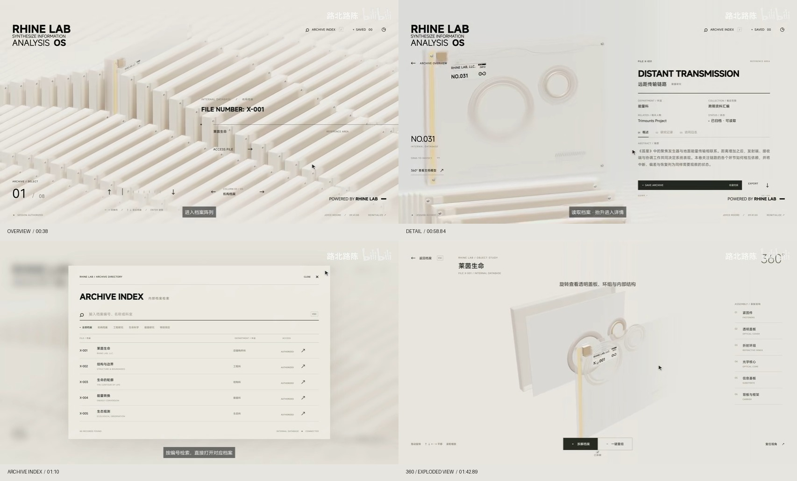

# ARCHIVEX 视频对照改动方案

状态：待确认草案。日期：2026-10-11。本轮交付方案与参考关键帧，尚未开始本方案的产品实现。

## 1. 目标与参考依据

将项目调整为视频中的沉浸式档案终端：密集的浅色立体档案阵列、统一的斜上方视角、连续的选择与抽出镜头，以及档案详情、检索收藏和 360° 结构查看。

**用户补充要求：动画不能少。以下动画属于本次必做范围，必须与对应功能一起交付、逐项验收；阶段顺序不代表可省略动画。**

参考为用户提供的本地视频，时长约 125.01 秒，分辨率 853 × 480。已提取 47 个关键帧；下列时间段用于定位画面，不代表已经精确测量动画时长。方案中的动画参数和技术选型属于实现建议。

| 视频位置 | 可观察到的内容 | 对项目的要求 |
| --- | --- | --- |
| 00:00–00:35 | 原片与复刻的并排演示；标志、环形线条、档案出现 | 作为开场视觉参考，比较界面属于视频展示本身 |
| 00:38–00:57 | 档案密集排列；编号、组别与选中文件变化；底部方向导航 | 建立阵列、选择状态和受控浏览镜头 |
| 00:58–01:08 | 选中文件放大转向，形成左侧档案、右侧详情；随后返回阵列 | 总览与详情使用连续的空间过渡 |
| 01:10–01:14 | ARCHIVE INDEX 检索弹层，按编号找到并进入档案 | 全量真实文件检索与直接定位 |
| 01:24–01:49 | 360° 查看、正背面旋转、拆解与重组 | 文件夹需要可旋转的完整几何结构 |
| 01:50–02:01 | 返回详情、收藏操作与 SAVED ARCHIVES 目录 | 本地持久收藏、取消收藏与收藏检索 |

## 2. 当前项目与目标的主要差距

| 当前实现 | 改动方向 |
| --- | --- |
| 文件夹由三个固定 CSS 多边形拼成；各面没有统一的真实空间关系 | 用同一套 3D 文件夹模型生成阵列、详情与查看模式 |
| 三行固定坐标、负向起点、固定高度，只能横向滚动 | 相机根据视口和当前选择构图，保证所有真实档案都可导航到达 |
| 悬停靠提高层级和向屏幕上方平移，移开后退回第一份信息 | 独立管理悬停和当前选择；文件沿自身竖直轴抽出，遮挡按实际深度计算 |
| 打开时等待 650 毫秒，再显示阅读弹窗 | 抽出、镜头移动、详情出现协同进行；返回恢复原组别与选中项 |
| ACCESS FILE 是没有点击行为的文字；没有组别控制和检索收藏 | 将视频中的主要操作做成真实按钮，并支持键盘 |
| 上一版只在狭窄的应用侧栏预览中检查过画面 | 按参考视频的横向构图验收，并检查常见桌面窗口尺寸 |

现有文档转换、清单读取、Markdown/Word/PDF 预览与下载能力可以接入新界面。当前清单有 37 份真实文件，均为 Markdown、分类均为“未分类”；其他格式仍需作为回归场景检查。

## 3. 推荐实现方式

建议采用 **Three.js 负责 3D 档案与相机，HTML/CSS 负责文字、导航和正文**。整体继续使用现有 Vite + TypeScript 项目，不需要为了本次改动引入新的页面框架。

继续扩展 CSS 透视适合固定角度和少量位移，但要同时实现视频中的正背面查看、绕物体旋转、真实遮挡和拆解，各面及动作的维护成本会明显增加。统一 3D 场景更适合这次视频中展示的完整交互。

总览优先采用接近正交的投影：先用正交相机匹配画面中近远档案尺寸比较一致的效果，再根据关键帧调整相机倾角、方位、缩放和目标点。这是根据画面的判断，不是对视频源代码的断言。Three.js 的 [OrthographicCamera](https://threejs.org/docs/pages/OrthographicCamera.html) 可保持物体的投影大小不随距离变化。

背景重复档案复用几何体和材质；数量增多时使用 [InstancedMesh](https://threejs.org/docs/pages/InstancedMesh.html) 降低绘制开销。用 [Raycaster](https://threejs.org/docs/pages/Raycaster.html) 识别实际可见表面，让指针选择与画面一致。360° 模式使用受约束的 [OrbitControls](https://threejs.org/docs/pages/OrbitControls.html) 管理旋转与缩放。

## 4. 具体改动

### A. 文件夹模型、材质与排列

- 文件夹由薄外壳、内页/背板、浅黄色装订条、角部紧固件、编号标签构成；近距离能看到视频中的大小环形构件和透明面板。
- 总览以奶白、灰白和浅燕麦色为主。选中提示集中于装订条、标签及抽出高度，控制整片封面的黄色染色。
- 用柔和环境光和低对比接触阴影表现厚度，统一所有档案的方向、边缘宽度和受光关系。
- 档案形成多个平行纵深组，整体延伸至画面边缘；通过间距、遮挡和相机取景达到参考的密度。
- 一份真实文档只对应一份可操作档案。建议每组最多 8 份；目前 37 份对应 5 组，最后一组为 5 份。后续按真实数量扩展，不显示虚构数量。
- 当文件数量少时收紧取景；空目录进入明确的空状态。背景装饰如需增加，只使用无编号、不可选择的抽象结构，并在视觉验收时单独评估是否需要。

### B. 总览界面与导航

- 左上：参考视频的紧凑粗体品牌排版与小号副标题。
- 右上：档案检索、收藏数量；视频中未能确认用途的图标不预设业务功能。
- 中右：当前编号、真实标题、分类/格式及 ACCESS FILE 按钮，以细线和留白形成信息区。
- 左下：当前组内位置 / 本组数量；底部中间提供前后档案、前后组的方向控制与组标签。
- 所有文字放在独立的界面层中，随视口自适应，避开被抽出的档案及页面边缘。
- 鼠标悬停预览，单击文件或 ACCESS FILE 进入详情；方向键移动选择，Enter 打开，Esc 返回。文字输入、正文滚动和 360° 操作期间暂停阵列快捷键。
- 按组首尾循环浏览；导航循环只改变选中状态和相机目标，不重复创建可操作文档。
- 分类筛选使用文档元数据。当前无分类时显示“全部档案”和“卷组 01”等中性组名。

### C. 动画与状态

建立明确的流程：**开场 → 总览 → 抽出过渡 → 详情 → 360° 查看 / 正文阅读 → 返回详情或总览**。检索和收藏作为覆盖层，关闭后恢复打开前的状态。

| 必做动画 | 动作要求 |
| --- | --- |
| 开场入场 | 品牌和环形线条出现，档案阵列分批进入，镜头落到可操作的总览位置；提供跳过与重播 |
| 阵列待机 | 档案以小幅、不同相位持续起伏，形成连续波动；避免整排同时跳动 |
| 悬停与选择 | 目标档案沿自身竖直方向抬升，上一份平滑回落；保持朝向与真实遮挡 |
| 切换档案和组别 | 相机平滑跟随新的目标，选中位置、刻度、编号和组别文字同步过渡；首尾循环保持连续 |
| 抽出并打开 | 文件继续抽出，相机平移、转向和调整取景，背景阵列逐步退开；动作衔接到详情构图 |
| 详情与正文展开 | 分隔线、标题、元信息和操作按顺序出现；页签及扩大正文区域有过渡，文字在稳定位置可读 |
| 返回归位 | 详情界面退场，镜头沿对应路径返回，文件落回原位置，恢复组别、选中项与焦点 |
| 检索和收藏面板 | 面板与背景虚化平滑进入、退出；结果定位衔接档案镜头；收藏按钮与数量提供短促反馈 |
| 360° 查看 | 进入时模型与镜头衔接，拖动旋转和缩放带平滑阻尼，复位与退出连续过渡 |
| 拆解与重组 | 面板、环形构件、背板和紧固件按层次错峰分离，重组时准确归位；零件说明同步出现 |

统一管理模型、相机和界面动画的进度与缓动。新选择从当前姿态接续，防止快速操作时瞬移或跳回起点；打开/关闭期间防止重复创建阅读层；Esc 中止过渡后平滑回到稳定状态。连续阅读中的正文保持稳定，不叠加影响阅读的漂浮动画。

建议首轮调参范围：选择 250–400 毫秒，进入详情 900–1400 毫秒，返回 700–1100 毫秒，拆解/重组 700–1000 毫秒。以上是建议值，最终以视频观感和操作响应校准。

### D. 档案详情与正文阅读

- 详情采用视频中的左右构图：左侧为选中的实体档案，右侧为真实文档信息和操作。
- 本地信息映射为标题、编号、分类、日期、文件格式、摘要；没有对应数据时隐藏该字段。
- 内容页签建议为“概览 / 正文”。视频中的部门、研究记录和访问记录只有在项目存在相应真实数据时才呈现。
- 正文支持扩大阅读区域，使长文和 PDF 能正常阅读；下载原文件继续可用。
- 预览读取失败显示可读的错误与下载入口；返回保留当前文件及场景位置。

### E. 检索与收藏

- 检索弹层复现参考的浅色面板、顶部搜索框、分类筛选、细分隔线及结果列表。
- 按显示编号、标题、摘要进行本地检索；选中结果时先关闭弹层，再定位并进入对应文件。
- 收藏使用现有稳定文件 ID，保存到浏览器本地存储；收藏计数、按钮状态和收藏目录同步更新。
- 文件被移除后过滤失效收藏；无结果、无收藏和存储不可用时有明确反馈。
- 显示编号与文件身份分开：排序变化不影响收藏。可在元数据中增加可选的自定义编号，用于需要长期固定编号的文档。

### F. 360° 查看与结构拆解

- 从详情进入独立的查看模式；拖动旋转、滚轮缩放、按钮复位，能观察正面、背面和厚度。
- “拆解 / 重组”控制透明盖板、环形构件、信息面板、背板和紧固件沿模型局部轴线分离或归位。
- 右侧零件说明对应模型中实际存在的部件；部件名称是模型结构说明，不作为真实文档的业务信息。
- 相机设置合理的距离与旋转约束，避免穿入模型；返回详情恢复原档案和界面状态。

### G. 开场演出

开场为必做项：以品牌、环形线条、档案阵列入场构成短开场，提供跳过和重播。进入过页面后默认直接进入可操作总览。具体时长建议 3–5 秒，不照搬视频中用于比较原片与复刻的演示时长。最终镜头在阵列稳定后统一校准，阶段安排不降低其交付优先级。

## 5. 文件与模块调整

| 文件/模块 | 计划职责 |
| --- | --- |
| `src/scene.ts` | 场景装配与生命周期，协调 3D 场景和界面层 |
| `src/layout.ts` | 世界坐标中的档案分组与位置计算，替换固定屏幕坐标 |
| `src/scene/ArchiveWorld.ts`（新增） | 相机、灯光、渲染、鼠标命中与场景资源释放 |
| `src/scene/ArchiveModel.ts`（新增） | 文件夹几何、标签、材质与拆解结构 |
| `src/scene/ArchiveMotion.ts`（新增） | 选择、镜头、抽出、归位和拆解动画 |
| `src/archive-state.ts`（新增） | 当前文件、组别、显示模式与过渡状态 |
| `src/ui/`（新增） | 总览信息、详情、检索和收藏界面 |
| `src/main.ts` | 用状态变化协调页面，替换仅靠定时器切换阅读层的流程 |
| `src/reader.ts` | 将现有文档阅读能力接入详情与扩大阅读模式 |
| `src/style.css` | 参考视频的排版、留白、分隔线和桌面视口适配 |
| `src/types.ts` / 构建脚本 | 仅在需要可选固定编号等字段时扩展兼容性 |

检索和收藏规模较小，先用轻量 TypeScript 状态管理。3D 渲染不可用时提供可操作的简化档案入口，保证文档阅读和下载可用。

## 6. 实施顺序与阶段验收

1. **动态场景样板**：制作可旋转的单份文件夹，再放入当前 37 份文档形成阵列；同时实现待机波动和选择抬升。对齐总览构图、比例、密度、光影，交付关键帧对照及动态预览。
2. **核心浏览闭环**：实现组内/组间选择、抽出镜头、详情展开和返回归位，接入原文阅读。验收每一份档案均可到达、打开、返回，位置与焦点一致，所有过渡连续。
3. **检索收藏**：实现两个目录面板、本地搜索、定位、收藏持久化及对应入退场和反馈动画；验证结果定位与镜头衔接。
4. **360° 与拆解**：在同一个文件夹模型上增加平滑旋转、缩放、拆解、重组、复位和返回，验收分层动作及模型一致性。
5. **开场和收尾**：完成可跳过、可重播的开场；逐项核验动画清单；完成性能、不同窗口尺寸及文档格式回归。

每阶段形成可在本地预览的结果。优先完成前两阶段，先验证最影响参考观感的档案造型、镜头和核心操作。

## 7. 最终验收标准

- 在 1920×1080 和 1440×900 下与关键帧对照，总览具有密集平行档案、统一斜上方视角、浅色材质和合理遮挡；详情呈现左档案、右文字的构图。
- 另检查 1280×720 和应用侧栏窄窗口：界面文字与主要控制不裁切，所有真实文档可通过导航或检索打开。
- 选择、打开、返回、切组和快速重复操作没有跳回首项、穿插、错误档案或遗留阅读层。
- 上述十类动画全部实现，并通过屏幕录制或实时动态预览逐项验收；静态截图仅用于构图与材质比较，不能代替动画验收。
- 正常操作有完整过渡，快速切换或中途返回能从当前姿态连续接续；开场的跳过和重播均正常，跳过后立即可操作。
- 360° 能观察背面；拆解再重组后各部件回到原位；进入/退出后文件身份一致。
- 搜索和收藏显示真实内容；刷新后收藏有效；原有 Markdown、Word、PDF、旧 DOC 下载及错误处理回归通过。
- 用实际目标桌面浏览器测量动画性能，目标为常见场景接近 60fps；按设备能力控制渲染分辨率与阴影质量，不预先承诺所有设备的帧率。
- 性能优化优先调整渲染分辨率、阴影和模型细节，保留必做动画的动作、顺序与连续性。

需要在实施中重点验证的风险是透明面板的遮挡排序、重复档案的渲染成本和镜头过渡被中断时的状态恢复。先做场景样板，可以在接入完整界面前确认这些问题。
